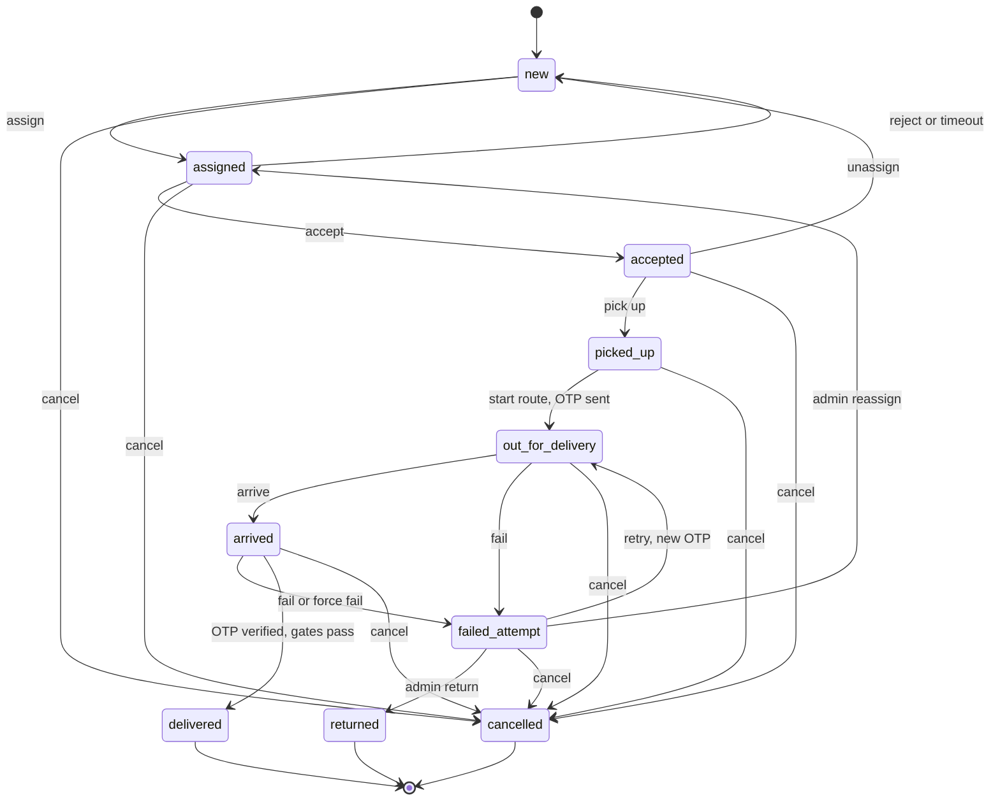

# U8.1 Delivery Core: Business Logic Model

Step-by-step flows. Rule ids refer to `business-rules.md`. This unit has no screens, so there is no `frontend-components.md`; the HTTP contract below is what U8.3 and U8.4 will call.

## 1. Status diagram



Text alternative: a job starts as new, is assigned, accepted, picked up, sent out, arrives and is delivered. Failures lead to retry, reassign, return or cancel. Reassign is also allowed from assigned, accepted, picked up and out for delivery (not drawn for readability). Delivered, returned and cancelled are final.

## 2. Transition engine (all job status changes)

```
transition(event, actor, jobId, input):
  edge = EDGES[event]                       // rule BR-D20
  begin transaction
    job = SELECT ... FROM delivery_jobs WHERE id = jobId FOR UPDATE
    if actor is partner and job.partnerId != actor.id (or not history-readable): 404
    if actor kind not in edge.actors: 403
    if repeat of same partner command: return job (BR-D23)
    if job.status not in edge.from: 409 INVALID_TRANSITION
    if order is cancelled and actor is partner: 409 ORDER_CANCELLED
    validate input (reason, code, location)  // BR-D25, BR-D26
    run TransitionGuards for reassigned/returned/cancelled   // BR-D45
    run event-specific step (see sections 3 to 7)
    run CompletionGates when event == delivered              // BR-D46
    UPDATE job SET status = edge.to, ... WHERE id = jobId AND status = job.status   // compare and set
    INSERT delivery_events
    OrderSync.apply(tx, job, edge.to, event, actor)         // BR-D50 to BR-D57
  commit
  after commit: enqueue notify job if the event needs one (U8.5), audit for admin events
```

Errors map to: `404` not found or not yours, `403` wrong actor kind, `409` illegal move or business conflict, `422` invalid input, `423` OTP locked, `429` too soon.

## 3. Assign

```
assign(admin, orderId, partnerId, note):
  order = load order with items, payments, address
  check order status (BR-D10), no active job, partner active and below capacity (BR-D11)
  destination = snapshot(address)  ; check pincode and OTP phone (BR-D12, BR-D30)
  begin transaction
    job = create job(status new) with code, tracking token, snapshots, paymentMode, codAmount
    FulfilmentService.cancelShipmentsForOrder(order) for non-inhouse shipments     // BR-D14
    shipment = create Shipment(provider inhouse, courier 'Belzo Delivery', awb job.code, status packed)
    assignment = create(partner, deadline = now + acceptTimeout)
    transition('assigned') new -> assigned     // writes event, order and shipment sync
  commit
  audit delivery.assign
```

For a job that is already in `new` (after reject or timeout) the same call re-uses the job and creates only a new assignment and the `assigned` move.

## 4. Partner commands

| Command | Event | Extra step |
|---|---|---|
| accept | accepted | assignment outcome `accepted` |
| reject(reason) | rejected | assignment `rejected`; clear partner; `attention = rejected` |
| pickUp(loc) | picked_up | none |
| start(loc) | out_for_delivery | issue OTP (section 5), `attemptNo = attemptsUsed + 1` |
| arrive(loc) | arrived | none |
| fail(code, note, loc) | failed_attempt | `attemptsUsed + 1`; if `attemptsUsed >= maxAttempts` then `attention = max_attempts` |
| retry(loc) | retry | allowed only if `attemptsUsed < maxAttempts`; issue OTP |
| verifyOtp(code) | none (OTP step) | section 5 |
| resendOtp | none (OTP step) | section 5 |
| complete(loc) | delivered | OTP verified and fresh (BR-D38); gates; set `deliveredAt`, `endedAt`, `trackingExpiresAt`; assignment `completed` |

`complete` takes no code: the code is checked by `verifyOtp` first (as in the PHP module), so the partner can collect payment and proof between the two steps. This replaces the single `complete(otp)` call in the application design's method list.

## 5. Delivery OTP

```
issueOtp(tx, job, attemptNo):
  supersede the active OTP of the job
  code = 6 random digits ; hash = HMAC_SHA256(pepper, jobId:attemptNo:code)
  insert DeliveryOtp(status active, sendStatus pending, expiresAt = now + otpValidMinutes, sendCount 1)
  after commit (outside the transaction): sms.send({to: job.otpPhone, otp: code, purpose: 'delivery'})
     on success: sendStatus sent, event otp_sent ; on failure: sendStatus failed (job unaffected)

resendOtp(partner, job):
  require status in (out_for_delivery, arrived), not locked
  require now - lastSent >= otpResendSeconds, else 429 with seconds left
  require sendCount < otpMaxSends, else 409 OTP_SEND_LIMIT
  issueOtp again with sendCount + 1 (same attemptNo)

verifyOtp(partner, job, code):
  require status == arrived
  if job.otpLockedUntil > now: 423
  otp = active OTP; none or expired: 410
  if timingSafeEqual(hash(code), otp.codeHash): otp.status = verified, verifiedAt = now, event otp_verified
  else wrongGuesses + 1 ; if >= otpMaxWrongGuesses: otp.status = locked, job.otpLockedUntil = now + lockout, event otp_locked ; 422
adminUnlockOtp(admin, job): clear otpLockedUntil ; audit ; partner then resends
adminChangeContact(admin, job, phone): update otpPhone ; event contact_changed ; audit
```

## 6. Order, shipment and timeline sync

```
OrderSync.apply(tx, job, toStatus, event, actor):
  shipment = job.shipment
  row = SYNC_TABLE[event]    // {orderStatus?, shipmentStatus?, trackingStatus, trackingText}
  insert TrackingEvent(shipment, status = row.trackingStatus, description = row.trackingText, occurredAt = now)
  if row.shipmentStatus and rank(row.shipmentStatus) >= rank(shipment.status): update shipment
  if row.orderStatus: walk the order forward one legal step at a time to the target (never backwards)
  if event == returned: cancelUndeliverable(order)   // stock back, refund prepaid, order cancelled, shipment rto
  if event == cancelled: cancel the shipment, order unchanged
```

`SYNC_TABLE` is the table in rules BR-D51 to BR-D57 and lives in `packages/shared` so tests can check it.

## 7. Background jobs (queue `delivery`)

| Job | Every | Steps |
|---|---|---|
| accept-timeout | 1 min | select up to 100 jobs with status `assigned` and `acceptDeadlineAt < now`; run `expired` for each in its own transaction; failures are logged and retried next minute |
| partner-stale | 1 min | set `isOnline = false` where online and `lastSeenAt < now - offlineAfterMinutes` |
| otp-cleanup | 1 h | mark active OTPs past `expiresAt` as `expired`; delete OTP rows older than 30 days |
| order.cancelled | on demand | find the order's active job and run `cancelled` as `system`; no job means nothing to do |

Each job upserts its scheduler by a fixed id, is safe to run twice, and the worker writes a heartbeat row that the health check reads (stale after 3 minutes).

## 8. Partner authentication

```
login(mobile, password, ip):
  mobile = normalise ; check lockout(kind partner) ; 429 if locked
  partner = find by mobile ; verify argon2id (dummy hash when not found, to keep timing equal)
  if wrong or inactive: record failure ; 401 'Invalid mobile or password'
  record success ; issue access token (JWT_PARTNER_SECRET, claim mcp = mustChangePassword) and refresh token (cookie belzo_prt)
refresh: rotate with reuse detection ; reject if the partner is inactive
logout: revoke family
changePassword(current, next): check current ; next != current ; set mustChangePassword = false ; revoke other families
guard: verify token ; load partner ; require active ; if mcp then only the change-password route ; touch lastSeenAt at most once per 60 s when online
```

## 9. HTTP contract of this unit

| Route | Who | Body or query | Result |
|---|---|---|---|
| `POST /partner/auth/login` | public | mobile, password | tokens, partner |
| `POST /partner/auth/refresh`, `/logout` | cookie | none | tokens |
| `POST /partner/auth/password` | partner | current, next | 204 |
| `GET /partner/me` | partner | | profile, counts |
| `POST /partner/me/online` | partner | online | 204 |
| `POST /partner/me/heartbeat` | partner | lat, lng optional | 204 |
| `GET /partner/jobs` | partner | `scope=active|history`, page | list (BR-D70, BR-D73) |
| `GET /partner/jobs/:id` | partner | | detail (BR-D70, BR-D71, BR-D72) |
| `POST /partner/jobs/:id/accept`, `reject`, `pickup`, `start`, `arrive`, `fail`, `retry`, `complete` | partner | per section 4 | job |
| `POST /partner/jobs/:id/otp/verify`, `/otp/resend` | partner | code | status of the OTP step, never the code |
| `POST /admin/orders/:orderId/assign` | order_manager | partnerId, note | job |
| `GET /admin/orders/:orderId/assign-options` | order_manager | | suggested partners |
| `GET /admin/delivery/jobs`, `/jobs/:id`, `/dashboard` | order_manager | filters | lists and counts |
| `POST /admin/delivery/jobs/:id/reassign`, `unassign`, `cancel`, `return`, `force-fail`, `otp-unlock`, `contact` | order_manager | reason, partnerId, phone | job |
| `GET/POST/PATCH /admin/delivery/partners`, `POST .../:id/active`, `.../:id/password` | order_manager | partner fields | partner |
| `GET/POST/PATCH/DELETE /admin/delivery/zones`, `PUT .../zones/:id/pincodes`, `PUT .../partners/:id/zones` | order_manager | zone fields | zone |
| `GET/PUT /admin/delivery/settings` | super_admin | settings | settings |

Validation uses zod schemas from `packages/shared`.

## 10. Error and edge cases

| Case | Behaviour |
|---|---|
| Two admins assign the same order at once | partial unique index; the second gets `409` |
| Partner accepts at the same moment the timeout runs | row lock; whoever commits first wins; the other gets `409` |
| Partner double-taps Start | second call is an idempotent replay (BR-D23); no second OTP |
| SMS provider down | job moves; partner sees failed send and can resend |
| Customer cancels the order while out for delivery | partner commands get `409 ORDER_CANCELLED`; worker cancels the job |
| Order's pincode has no zone | suggestions are not zone-ordered; assign still works |
| Partner deactivated with active jobs | allowed; the admin sees those jobs with a "partner inactive" note and reassigns them; the partner is signed out |
| Customer address edited after assignment | the job keeps its snapshot |
| Clock skew between API and worker | all deadlines use the database time (`now()` in SQL) |
