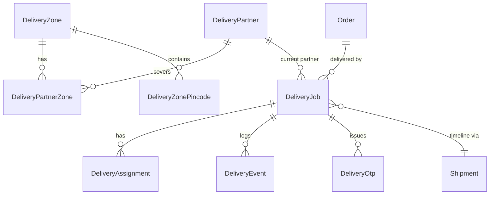

# U8.1 Delivery Core: Domain Entities

Technology-agnostic description. Names follow the Prisma naming Belzo already uses (`PascalCase` model, `snake_case` table through `@@map`). Money is integer paise. Times are UTC. Ids are UUID strings.

## 1. Entities

### DeliveryPartner
| Field | Type | Notes |
|---|---|---|
| id | uuid | |
| name | text 2 to 80 | |
| mobile | text, 10 digits, unique | login id, starts with 6 to 9 |
| email | text, optional | |
| passwordHash | text | argon2id |
| mustChangePassword | bool | true after admin sets or resets the password |
| vehicleType, vehicleNumber | text, optional | |
| isActive | bool | inactive partners cannot log in or receive jobs |
| isOnline | bool | set by the partner; cleared by the stale job |
| lastSeenAt | time, optional | any authenticated call by an online partner, at most once per 60 s |
| lastLat, lastLng | decimal, optional | last GPS point sent |
| maxActiveJobs | int, default 10 | per partner, editable |
| createdById | admin id | |
| createdAt, updatedAt | time | |

### DeliveryZone, DeliveryZonePincode, DeliveryPartnerZone
- `DeliveryZone`: id, name (unique, 2 to 60), isActive.
- `DeliveryZonePincode`: zoneId, pincode (6 digits). A pincode belongs to at most one zone (unique on pincode).
- `DeliveryPartnerZone`: partnerId, zoneId (composite key). A partner can cover many zones.

### DeliveryJob
One job per delivery of one `Order`. A new job is made when an order is assigned and no active job exists.

| Field | Type | Notes |
|---|---|---|
| id | uuid | |
| code | text, unique | `DLV-` + 8 characters from an alphabet without look-alike characters |
| orderId | uuid, FK Order | at most one active job per order (partial unique index) |
| status | enum | the 10 statuses |
| partnerId | uuid, optional | current partner; null in `new` |
| currentAssignmentId | uuid, optional | |
| shipmentId | uuid, optional | the `inhouse` Shipment |
| attemptsUsed | int, default 0 | failed attempts for the current assignment |
| maxAttempts | int | copy of the setting at creation |
| paymentMode | `cod` or `prepaid` | from the order's payment |
| codAmount | int paise | grand total for COD, 0 for prepaid |
| itemCount | int | number of units |
| destName, destPhone | text | snapshot from the delivery address |
| destLine1, destLine2, destCity, destState, destPincode | text | snapshot |
| otpPhone | text, 10 digits | the number the OTP goes to (see FD4) |
| otpLockedUntil | time, optional | set after too many wrong guesses |
| zoneId | uuid, optional | zone of the pincode at creation |
| trackingToken | text, unique | 32 random bytes, base64url |
| trackingExpiresAt | time, optional | set to end time + 30 days when final |
| attention | enum, optional | `rejected`, `no_reply`, `max_attempts`, `payment_review` (U8.2) |
| acceptDeadlineAt | time, optional | while `assigned` |
| deliveredAt, endedAt | time, optional | |
| createdAt, updatedAt | time | |

Snapshots keep the job correct if the customer later edits the saved address.

### DeliveryAssignment
| Field | Notes |
|---|---|
| id, jobId, partnerId | |
| assignedByKind, assignedById | `admin` or `system` |
| assignedAt, responseDeadlineAt, respondedAt | |
| outcome | `pending`, `accepted`, `rejected`, `expired`, `unassigned`, `reassigned`, `completed`, `cancelled` |
| reason | text, optional (reject reason 3 to 255) |

At most one `pending` or `accepted` assignment per job (partial unique index).

### DeliveryEvent (append-only)
id, jobId, event (`assigned`, `reassigned`, `accepted`, `rejected`, `expired`, `unassigned`, `picked_up`, `out_for_delivery`, `arrived`, `failed_attempt`, `force_failed`, `delivered`, `retry`, `returned`, `cancelled`, plus non-status notes `otp_sent`, `otp_verified`, `otp_locked`, `otp_unlocked`, `contact_changed`), fromStatus, toStatus, actorKind (`admin`, `partner`, `system`), actorId, reasonCode, note (up to 500), lat, lng, attemptNo, meta (json), createdAt. Rows are never updated or deleted.

### DeliveryOtp
| Field | Notes |
|---|---|
| id, jobId, assignmentId | |
| attemptNo | 1-based delivery attempt (the n-th route start) |
| phone | the number used |
| codeHash | HMAC-SHA256 hex with `DELIVERY_OTP_PEPPER` of `jobId:attemptNo:code` |
| status | `active`, `verified`, `expired`, `superseded`, `locked` |
| sendStatus | `pending`, `sent`, `failed` |
| wrongGuesses | int |
| sendCount | int (sends for this attempt) |
| expiresAt, sentAt, verifiedAt, createdAt | |

At most one `active` OTP per job (partial unique index). The code itself is never stored.

### Settings (stored in `Setting` as `delivery.*`)
| Key | Default |
|---|---|
| delivery.acceptTimeoutMinutes | 15 |
| delivery.maxAttempts | 3 |
| delivery.defaultMaxActiveJobs | 10 |
| delivery.offlineAfterMinutes | 30 |
| delivery.otpValidMinutes | 240 |
| delivery.otpVerifiedFreshMinutes | 30 |
| delivery.otpMaxWrongGuesses | 5 |
| delivery.otpLockoutMinutes | 15 |
| delivery.otpResendSeconds | 60 |
| delivery.otpMaxSends | 5 |
| delivery.trackingDays | 30 |

U8.2 adds proof, QR and earnings keys.

### Changes to existing tables
- `PrincipalKind` enum gains `partner` (used by `RefreshToken` and `LoginAttempt`).
- No columns are added to `Order`, `Shipment` or `Payment`. The `inhouse` Shipment uses `provider = 'inhouse'`, `courier = 'Belzo Delivery'`, `awb = job code`.

## 2. Relationships

Text alternative: an Order can have many jobs over time, but only one active; a job has assignments, events and OTPs and points at one Shipment; zones link partners to pincodes.

## 3. Database guarantees (migration 1)

| Guarantee | How |
|---|---|
| One active job per order | partial unique index on `orderId` where status not in (`delivered`, `returned`, `cancelled`) |
| One open assignment per job | partial unique index where outcome in (`pending`, `accepted`) |
| One active OTP per job | partial unique index where status = `active` |
| Events are append-only | trigger rejects UPDATE and DELETE on `delivery_events` |
| Final statuses are final | trigger rejects any status change once the old status is `delivered`, `returned` or `cancelled` |
| Delivered needs a verified OTP | trigger rejects `status = delivered` unless a `verified` OTP exists for the job |
| Valid mobile, pincode | check constraints |
| Query speed | indexes on `(partnerId, status)`, `(status, acceptDeadlineAt)`, `(orderId)`, `(trackingToken)` unique, `(jobId, createdAt)` on events |
