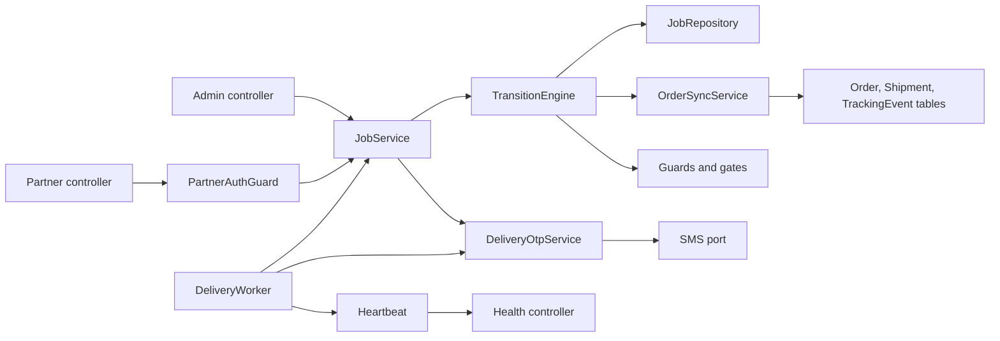

# U8.1 Delivery Core: Logical Components

Existing components are reused; the new ones are small. Paths are under `apps/api/src` unless noted.

## 1. New components

| Component | Location | Purpose | Pattern |
|---|---|---|---|
| `PartnerAuthGuard` and `@CurrentPartner()` | `modules/delivery/partners/partner-auth.guard.ts` | verify partner token with `JWT_PARTNER_SECRET`, load partner, enforce active and `mcp` | SP1 |
| `PartnerTokenService` | `modules/delivery/partners/partner-token.service.ts` | issue and rotate partner tokens (wraps the existing refresh-token table with `principalKind = partner`) | SP3 |
| `PartnerAuthService` | `modules/delivery/partners/partner-auth.service.ts` | login, refresh, logout, change password | SP3 |
| `PasswordDenylist` | `packages/shared/src/delivery/password-denylist.ts` | common passwords and own-mobile check, used by API and web forms | SP3 |
| `JobRepository` | `modules/delivery/jobs/job.repository.ts` | the only code that reads or writes job tables; scoped finders (`findForPartner`, `findForAdmin`); `lockForUpdate` | SP2, RP1 |
| `TransitionEngine` | `modules/delivery/jobs/transition-engine.ts` | one function for all job status changes (functional design section 2) | RP1 |
| `OrderSyncService` | `modules/delivery/jobs/order-sync.service.ts` | order, shipment and tracking-event updates from the sync table | BR-D50 to 57 |
| `TransitionGuard` / `CompletionGate` registries | `modules/delivery/jobs/gates.ts` | extension points for U8.2 | BR-D45, 46 |
| `OtpHasher` and `DeliveryOtpService` | `modules/delivery/otp/` | create, hash, send after commit, verify, resend, lock, unlock | SP4 |
| `DeliverySettingsService` | `modules/delivery/settings/` | typed `delivery.*` settings with defaults | |
| `SecurityEventLogger` | `modules/delivery/security-events.ts` | emits the fixed event names (SP8) and keeps the dashboard counters via log-derived counts in the database table `delivery_events` and `login_attempts` | SP8 |
| `DeliveryWorker` | `modules/delivery/worker/delivery.worker.ts` | BullMQ consumer, schedulers, heartbeat | RP3 |
| `DeliveryHeartbeat` | `modules/delivery/worker/heartbeat.ts` | writes the heartbeat `Setting` row `delivery.workerHeartbeat`; read by the health controller | RP3 |
| `PartnersController`, `PartnerJobsController`, `AdminDeliveryController`, `AdminDeliverySettingsController` | `modules/delivery/{partner-api,admin}/` | HTTP surface | SP2, SP5 |
| Shared package | `packages/shared/src/delivery/` | `status.ts`, `sync-table.ts`, `schemas.ts`, `money.ts`, `password-denylist.ts`, tests with arbitraries | PBT |

## 2. Changes to existing components

| Existing | Change | Reason |
|---|---|---|
| `env.schema.ts`, `docker-compose.prod.yml`, `.env.example` | add `JWT_PARTNER_SECRET` (min 32 chars) and `DELIVERY_OTP_PEPPER` (min 32 chars) | SP1, SP4, fail closed |
| `prisma/schema.prisma` | `PrincipalKind` gains `partner`; new delivery models | migration 1 (additive, with triggers in raw SQL) |
| `common/auth/jwt.types.ts`, `refresh-cookie.ts` | add `partner` kind and scope `belzo_prt` | SP3 |
| `common/queue/queue.constants.ts` | add `QUEUES.DELIVERY` | RP3 |
| `QueueService` | allow adding a repeatable scheduler (`upsertJobScheduler`) | RP3 |
| `FulfilmentService.createShipment` | return early when an active `DeliveryJob` exists | BR-D59 |
| `OrderService.cancel` (and the system cancel for undeliverable) | enqueue `order.cancelled` on the delivery queue; add the system-only path for shipped and out-for-delivery orders | BR-D56, 58 |
| `ORDER_TRANSITIONS` / shared helpers | `shipped` and `out_for_delivery` may go to `cancelled` for the system action only (customer cancel rules unchanged) | BR-D56 |
| `TRACKING_STATUS_LABELS`, `TRACKING_PROGRESS_MAP` (shared) | add `assigned`, `accepted`, `arrived`, `failed_attempt` | BR-D60 |
| `common/health/health.controller.ts` | add the delivery worker heartbeat check (soft) | RP3 |
| logger redaction list | add `code`, `otp`, `password`, `refreshToken`, `partnerToken` | SP7 |
| `prisma/seed.ts` | none for roles (D3 reuses `order_manager`); optional demo partner only in development seed | |

## 3. Component interaction (U8.1)

Text alternative: controllers call JobService; the partner controller passes through PartnerAuthGuard; JobService uses the TransitionEngine, which uses the repository, the order sync service and the registered guards and gates; the OTP service sends through the SMS port; the worker calls JobService and the OTP service and writes the heartbeat that the health controller reads.

## 4. Data stores and queues

| Store | Use | Notes |
|---|---|---|
| Postgres (existing) | all delivery tables, settings, audit | additive migration; triggers for append-only and delivered guard |
| Redis / BullMQ (existing) | queue `delivery` with 4 job kinds | state is in Postgres, so a Redis outage never loses a delivery |
| Storage | not used in U8.1 | proof arrives in U8.2 |

## 5. Environment and secrets

| Variable | Required | Notes |
|---|---|---|
| `JWT_PARTNER_SECRET` | yes, 32+ characters | different from `JWT_ACCESS_SECRET`; generate with `openssl rand -base64 48`; add to the server `.env.prod` at deploy time |
| `DELIVERY_OTP_PEPPER` | yes, 32+ characters | changing it only invalidates codes in flight |

## 6. Compliance summary (design level)

Platform-level controls (encryption at rest and in transit, load balancer and network rules, log retention, patching, supply chain scanning, quotas, multi-zone) belong to the platform and deployment, were decided in U1 and the resiliency decisions, and are not changed by U8.1, which adds no infrastructure and no new kind of data store. They are marked "inherited". Note: the U1 design planned managed RDS and encrypted storage; the current live host runs Postgres in Docker on one server. That gap exists today and is outside this unit; it is listed here so it is not forgotten.

### Security Baseline

| Rule | Status | Evidence |
|---|---|---|
| SECURITY-01 Encryption | Inherited, unchanged | same Postgres; no new store; see note above |
| SECURITY-02 Access logs on intermediaries | N/A | no new intermediary |
| SECURITY-03 Application logging | Compliant | existing pino logger with request ids; redaction extended; masked mobiles (SP7) |
| SECURITY-04 HTTP security headers | Inherited, extended in U8.4 | API uses helmet; partner pages are served by the web app and checked in U8.4 |
| SECURITY-05 Input validation | Compliant | SP5 |
| SECURITY-06 Least privilege | Compliant | roles per route (SP2); no wildcard access; worker uses the existing role |
| SECURITY-07 Network config | N/A | no network change |
| SECURITY-08 Access control | Compliant | deny by default, separate realm, object-level scoping, role checks, server-side token validation (SP1, SP2); CORS allow-list unchanged |
| SECURITY-09 Hardening | Compliant | generic errors, no default secrets, fail at start-up without secrets (SP1, SP9) |
| SECURITY-10 Supply chain | Compliant | no new dependency planned; lock file stays committed |
| SECURITY-11 Secure design | Compliant | security logic isolated in guard, token and OTP modules; rate limits; 8 misuse cases listed |
| SECURITY-12 Authentication | Compliant with noted choices | adaptive hash, strong policy plus deny list, lockout, cookie flags, expiry and logout; MFA not offered to partners (optional for non-admins) |
| SECURITY-13 Integrity and audit | Compliant | audit log, append-only triggers (SP6) |
| SECURITY-14 Alerting and monitoring | Compliant for the chosen scope | security events and dashboard counters (NQ1 = A); log retention inherited from the platform |
| SECURITY-15 Exceptions and fail-safe | Compliant | SP9, RP1, RP2 |

No blocking security findings.

### Resiliency Baseline

| Rule | Status | Evidence |
|---|---|---|
| RESILIENCY-01 Workload criticality | Compliant | delivery module is High (revenue: orders cannot be delivered or COD cash tracked; users: partners and customers); dependencies mapped in `component-dependency.md` |
| RESILIENCY-02 Targets | Inherited | RTO and RPO in hours (decision R1 = A) |
| RESILIENCY-03 Change management | Inherited | decision R3 = B |
| RESILIENCY-04 Deployment and rollback | Inherited | decisions R4 to R6; migration is additive; deploy only on request |
| RESILIENCY-05 Monitoring | Compliant for scope | RP4 |
| RESILIENCY-06 Health checks | Compliant | RP3 |
| RESILIENCY-07 Resiliency monitoring | Compliant for scope | worker heartbeat and queue failures visible; no external assessment tool (documented as a later improvement) |
| RESILIENCY-08 Topology | Inherited | decision R2 = A |
| RESILIENCY-09 Capacity | Compliant | RP6 |
| RESILIENCY-10 Dependency isolation | Compliant | RP1, RP2 |
| RESILIENCY-11 DR strategy | Inherited | backup and restore (R1 = A) |
| RESILIENCY-12 Backups | Inherited | RP5 |
| RESILIENCY-13 Failover procedures | Inherited | no change by this unit |
| RESILIENCY-14 Resiliency testing | Inherited | decision R8 = C (Operations) |
| RESILIENCY-15 Incident response | Inherited | decision R7 = B |

No blocking resiliency findings.

### Property-Based Testing

| Rule | Status |
|---|---|
| PBT-01 | Compliant (properties P1 to P14 with categories) |
| PBT-02 | Compliant (P11) |
| PBT-03 | Compliant |
| PBT-04 | Compliant (P10, P11) |
| PBT-05 | Compliant (P3) |
| PBT-06 | Compliant (P4) |
| PBT-07 | Planned for Code Generation (generators listed) |
| PBT-08 | Planned for Code Generation and Build and Test (seed logging) |
| PBT-09 | Compliant (fast-check 3.20.0 already installed) |
| PBT-10 | Planned for Code Generation (example tests listed) |

No blocking PBT findings.
