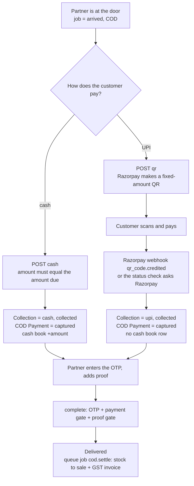

# U8.2 Collection, Cash and Proof: Business Logic Model

Rule ids refer to `business-rules.md`. This unit adds API only (the screens are U8.3 and U8.4), so there is no `frontend-components.md`.

## 1. Collection at the door



Text alternative: at the door the partner takes cash or shows a UPI QR; either way a standing collection and a captured COD payment result (cash also adds a cash book row); then the OTP and proof are done and the delivery completes, after which stock and invoice are settled.

## 2. Cash

```
collectCash(partner, jobId, amountPaise):
  begin transaction
    job = lockJob(jobId) ; scope check -> 404
    require job.paymentMode == cod            // NO_COLLECTION_NEEDED
    require job.status == arrived             // INVALID_TRANSITION
    standing = collection(job, collected)
    if standing and standing.method == cash and standing.amount == amountPaise: return standing   // replay
    if standing: ALREADY_COLLECTED
    if amountPaise != job.codAmount: AMOUNT_MISMATCH
    collection = insert(cash, collected, amount)
    payment = COD payment of the order ; set captured, method cash          // compare-and-set from pending
    ledger.post(partner, collected, +amount, jobId, collectionId)            // locks the partner row
    event cash_collected
  commit
```

## 3. UPI QR

```
showQr(partner, jobId):
  tx 1: lockJob ; same checks as cash (arrived, COD, no standing collection) ; settings.upiQrEnabled
        close the active QR row (status closed) ; remember its provider id
  after tx 1: razorpay.closeQr(old)                     // best effort
  razorpay.createUpiQr({amount, notes, closeBy = now+16 min})     // outside any transaction
      on error -> QR_UNAVAILABLE (nothing stored)
  tx 2: insert QR(active, expiresAt = now + qrValidityMinutes)
        if the unique "one active QR" index fires: razorpay.closeQr(new) ; return the existing active QR
  return {imageUrl, amount, expiresAt}

qrStatus(partner, jobId):
  qr = latest QR of the job (scoped to the partner)
  if none -> none
  if standing collection of method upi -> paid
  if qr active and qr.expiresAt < now: mark expired ; closeQr(best effort) -> expired
  if qr active and now - lastCheckedAt >= 5 s:
      set lastCheckedAt ; payments = razorpay.fetchQrPayments(qr) ; for each captured payment: creditUpi(...)
  return waiting | paid | expired
```

### Crediting (shared by webhook and status check)

```
creditUpi({providerQrId, providerPaymentId, amountPaise, method}):
  qr = find QR by providerQrId ; not ours -> 'ignored'
  begin transaction
    job = lockJob(qr.jobId)
    if collection with providerPaymentId exists -> return 'already_processed'     // idempotent
    standing = standing collection of job
    if job active and no standing and amountPaise == qr.amount:
        insert collection(upi, collected) ; qr.status = paid ; Payment captured (method upi, providerPaymentId)
        event upi_collected
    else:
        insert collection(upi, needs_refund) ; job.attention = payment_review ; event upi_needs_refund
  commit
```

Webhook route: `PaymentService.handleWebhook` verifies the signature, records the event id, sees an event starting with `qr_code.` and calls `WebhookEventRouter`, which calls `creditUpi` for `qr_code.credited` and ignores the other `qr_code.*` events (`created`, `closed`).

## 4. Cash book, settlement, void, refund

```
post(tx, partnerId, kind, amount, refs):
  lock the partner row ; last = latest entry of the partner
  seq = last.seq + 1 ; balance = last.balance + amount
  insert entry (database trigger re-checks seq, balance and sign)

settle(admin, partnerId, amount, method, reference):
  require 1 <= amount <= cashInHand(partner)            // SETTLEMENT_TOO_LARGE
  tx: insert settlement ; post(settled, -amount) ; audit

adjust(admin, partnerId, amount != 0, reason): tx: post(adjustment, amount) ; audit

voidCash(admin, collectionId, reason):
  tx: lockJob(collection.jobId) ; require collection cash + collected ; require job.status != delivered
      collection.status = voided ; Payment -> pending ; post(void, -amount) ; event cash_voided ; audit

refundUpi(admin, collectionId, reason):
  require collection upi and (needs_refund, or collected with job not delivered)
  razorpay.createRefund(providerPaymentId, amount)       // outside the transaction ; failure -> REFUND_FAILED, no change
  tx: collection.status = refunded ; if it was collected: Payment -> pending ; event upi_refunded ; audit
```

## 5. Proof

```
addPhoto(partner, jobId, file):
  tx: lockJob ; scope ; require arrived ; count live photos of the attempt < 3 (PROOF_LIMIT)
  detect type from the first bytes (jpeg / png / webp) else PROOF_INVALID ; size <= 8 MB
  key = delivery-proof/<jobId>/<random>.<ext from detected type>
  storage.put(key, bytes)                                // outside the transaction ; on later failure, delete the file
  tx: insert proof(photo) ; event proof_added

addSignature(partner, jobId, dataUrl):
  decode ; size <= 200 KB ; PNG signature check ; store like a photo
  tx: previous live signature gets supersededAt ; insert new ; event proof_added

proofSatisfied(rule, photos, hasSignature)               // pure, shared
```

## 6. Guards and gates (registered at start-up)

```
PaymentGuard.check(tx, job, move, actor)       // for reassigned, returned, cancelled
  if actor is admin and standing collection exists: refuse (void or refund first)
  if move == returned and an open needs_refund exists: refuse
  else allow

PaymentGate.check(tx, job)                     // before delivered
  if job is COD and no standing collection: PAYMENT_PENDING

ProofGate.check(tx, job)                       // before delivered
  if not proofSatisfied(setting, livePhotos, liveSignature): PROOF_REQUIRED

SystemCancelListener (after commit of a system cancel)
  if a standing collection existed: job.attention = payment_review
```

## 7. COD settlement after delivery

```
afterCommit(move == delivered and job is COD): enqueue cod.settle {orderId, jobId} with job id "cod-settle:<jobId>"

cod.settle handler:
  for each order item: if no StockMovement(reason sale, ref = orderId, variant) -> inventory.confirmSale
  invoices.generate(orderId)                    // returns the existing invoice if there is one
  both steps are safe to repeat ; any error -> retry by the queue

hourly sweep: delivered COD jobs of the last 7 days whose order has no invoice -> enqueue cod.settle again (limit 50)
```

## 8. Worker jobs added

| Job | Every | Steps |
|---|---|---|
| qr-expiry | 1 min | active QRs past `expiresAt`: mark expired, close at Razorpay (limit 100) |
| cod.settle | on demand | section 7 |
| cod-settle-sweep | 1 h | section 7 |

## 9. HTTP contract added

| Route | Who | Body | Result |
|---|---|---|---|
| `GET /partner/jobs/:id/payment` | partner | | amount due, status, method, QR state |
| `POST /partner/jobs/:id/cash` | partner | `{ amountPaise }` | collection |
| `POST /partner/jobs/:id/qr` | partner | `{}` | `{ imageUrl, amountPaise, expiresAt }` |
| `GET /partner/jobs/:id/qr/status` | partner | | `{ state, imageUrl?, expiresAt? }` |
| `POST /partner/jobs/:id/qr/mock-paid` | partner | `{}` | only when `PAYMENT_PROVIDER=mock`; otherwise 404 |
| `POST /partner/jobs/:id/proof/photo` | partner | multipart `file` | proof item |
| `POST /partner/jobs/:id/proof/signature` | partner | `{ image }` | proof item |
| `GET /partner/cash` | partner | | cash in hand, last 30 days of rows |
| `GET /admin/delivery/cash` | super_admin | | partners with cash in hand, refunds waiting |
| `GET /admin/delivery/cash/:partnerId` | super_admin | page | statement |
| `POST /admin/delivery/cash/:partnerId/settle`, `/adjust` | super_admin | amount, method or reason | entry |
| `GET /admin/delivery/collections` | super_admin | `?status=needs_refund` | list |
| `POST /admin/delivery/collections/:id/void`, `/refund` | super_admin | `{ reason }` | collection |
| `POST /payments/webhook` (existing) | Razorpay | | new `qr_code.*` branch |

Job views gain a `payment` block and a `proof` block, and `nextActions` gains `collect_cash`, `show_qr`, `add_proof`. Staff job detail gains the collections and the proof files.

## 10. Edge cases

| Case | Behaviour |
|---|---|
| Customer pays the QR twice | the second payment is a `needs_refund` collection and the job is flagged |
| Customer pays a QR after the partner took cash | `needs_refund`, flagged |
| QR paid after our 10 minutes but Razorpay's QR is still open | accepted if no collection stands |
| Partner fails the attempt after taking cash | the collection stays; the next attempt needs no new payment |
| Admin cancels a job that holds cash | refused until the cash is voided |
| Order cancelled by the customer while the partner holds cash | the job is cancelled, flagged `payment_review`, staff void the cash |
| Razorpay QR Codes not enabled | partner is told to collect cash; admin can switch `upiQrEnabled` off |
| Webhook secret or event not set up | the status check still finds the payment within a few seconds |
| Server restarts between delivery and `cod.settle` | the hourly sweep enqueues it again |
| Photo upload fails halfway | the stored file is removed |
