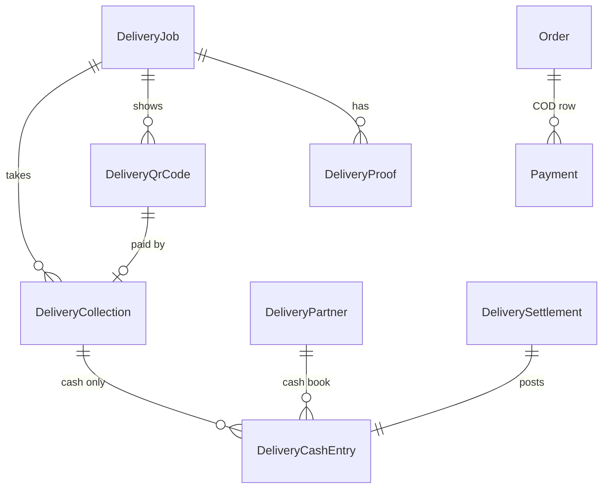

# U8.2 Collection, Cash and Proof: Domain Entities

Answers applied: FQ1 = A (COD stock and invoice are settled when the delivery completes), FQ2 = A (no earnings), FQ3 = A (no cash limit). So there is **no** `DeliveryEarning` table, no per-partner fee, and no cash-limit setting. Money is integer paise. Migration 2 is additive.

## 1. Entities

### DeliveryCollection
The money taken for a COD job. One row per payment that reached us.

| Field | Type | Notes |
|---|---|---|
| id | uuid | |
| jobId | FK DeliveryJob | |
| attemptNo | int | delivery attempt in which it was taken |
| method | `cash` or `upi` | |
| status | `collected`, `voided`, `needs_refund`, `refunded` | |
| amountPaise | int > 0 | cash: the amount confirmed; UPI: what Razorpay received |
| qrId | FK DeliveryQrCode, optional | UPI only |
| providerPaymentId | text, optional | Razorpay payment id (`pay_...`), UPI only; unique when set |
| collectedByPartnerId | FK DeliveryPartner | cash: who took it; UPI: who showed the QR |
| collectedAt | time | |
| voidedAt, voidedById, voidReason | optional | cash only |
| refundedAt, refundedById, refundReason, providerRefundId | optional | UPI only |
| createdAt | time | |

- At most one row with `status = collected` per job (partial unique index). That row is "the standing collection".
- `needs_refund` rows can exist next to a standing one (a late or double payment).
- Allowed status changes: `collected` to `voided` (cash), `collected` to `refunded` (UPI), `needs_refund` to `refunded`. A trigger refuses any other change and refuses changing amount, method or ids.

### DeliveryQrCode
A Razorpay UPI QR made for one job.

| Field | Type | Notes |
|---|---|---|
| id | uuid | |
| jobId | FK DeliveryJob | |
| attemptNo | int | |
| providerQrId | text, unique | `qr_...` |
| amountPaise | int | the COD amount at the time |
| imageUrl | text | the picture link from Razorpay |
| status | `active`, `paid`, `expired`, `closed` | |
| createdByPartnerId | FK DeliveryPartner | |
| expiresAt | time | our window (default 10 minutes) |
| closedAt | optional | |
| lastCheckedAt | optional | last time we asked Razorpay (limits the checks to one per 5 seconds) |
| createdAt | time | |

- At most one `active` QR per job (partial unique index).

### DeliveryCashEntry (append-only)
The partner's cash book.

| Field | Type | Notes |
|---|---|---|
| id | uuid | |
| partnerId | FK | |
| seq | bigint | 1, 2, 3 ... per partner, no gaps; unique with `partnerId` |
| kind | `collected`, `settled`, `adjustment`, `void` | |
| amountPaise | int, signed | collected +, settled -, void -, adjustment +/- (not 0) |
| balanceAfterPaise | int | running balance (may be negative: the office owes the partner) |
| jobId, collectionId, settlementId | optional FKs | |
| note | text, optional | reason, reference |
| actorKind, actorId | `partner`, `admin`, `system` | |
| createdAt | time | |

- Triggers: no UPDATE or DELETE; `seq` must be the previous `seq` + 1 for that partner; `balanceAfterPaise` must equal the previous balance plus `amountPaise`; sign rules per kind.
- Only **cash** collections appear here. UPI money never does.

### DeliverySettlement
| Field | Notes |
|---|---|
| id, partnerId | |
| amountPaise | > 0 |
| method | `cash_deposit`, `bank_transfer`, `upi` |
| reference | optional, up to 60 characters |
| note | optional |
| settledById | admin id |
| createdAt | |

### DeliveryProof
| Field | Notes |
|---|---|
| id, jobId, attemptNo | |
| kind | `photo` or `signature` |
| storageKey, url | where the file is stored; both become empty when the file is deleted after the retention period |
| purgedAt | optional; set when the file was deleted (NQ1 = A: one year after delivery); the row stays and shows "photo taken on <date>" |
| contentType | from the file content (`image/jpeg`, `image/png`, `image/webp`) |
| sizeBytes | |
| takenByPartnerId | |
| supersededAt | optional; set when a newer signature replaces it |
| createdAt | |

- At most one live signature per job and attempt (partial unique index where `kind = signature` and `supersededAt` is null).
- The 3-photo limit per attempt is enforced in the service inside the job lock.

### New settings (stored as `delivery.*`)
| Key | Type | Default | Range |
|---|---|---|---|
| upiQrEnabled | boolean | true | |
| qrValidityMinutes | int | 10 | 5 to 30 |
| proofRule | `none`, `photo`, `signature`, `any`, `both` | `any` | |

The shared settings module learns boolean and choice settings (it only knew whole numbers).

### Changes to existing tables
- `Payment` (COD row): `status` pending to captured, `method` `cash` or `upi`, `providerPaymentId` set for UPI. Back to pending when a cash collection is voided or a standing UPI collection is refunded before delivery. No new columns.
- `DeliveryJob`: no new columns. `attention = payment_review` (already in the enum) marks a job whose money needs a person.
- `WebhookEvent`: reused for idempotency of Razorpay events.

## 2. Relationships

Text alternative: a job has collections, QR codes and proof files; cash collections and settlements post rows to the partner's cash book; the collection also updates the order's COD payment.

## 3. Database guarantees (migration 2)

| Guarantee | How |
|---|---|
| One standing collection per job | partial unique index on `jobId` where `status = 'collected'` |
| One Razorpay payment is counted once | unique index on `providerPaymentId` where not null |
| One active QR per job | partial unique index on `jobId` where `status = 'active'` |
| One live signature per attempt | partial unique index |
| Cash book cannot be edited or have gaps | append-only trigger, `seq` and balance chain trigger, sign checks |
| Collections only change in allowed ways | trigger on `delivery_collections` |
| Positive amounts | check constraints |
