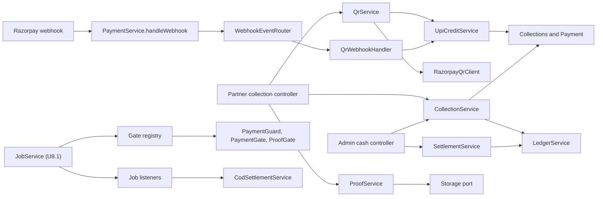

# U8.2 Collection, Cash and Proof: Logical Components

Paths are under `apps/api/src` unless noted.

## 1. New components

| Component | Location | Purpose | Pattern |
|---|---|---|---|
| `CollectionService` | `modules/delivery/collection/collection.service.ts` | amount due, cash, standing collection, replay, void, UPI refund | SP10, RP8 |
| `QrService` | `modules/delivery/collection/qr.service.ts` | create and close QR, status check with throttled Razorpay lookup, expiry | SP11, RP7, RP8 |
| `UpiCreditService` | `modules/delivery/collection/upi-credit.service.ts` | the one place that credits a UPI payment (webhook and status check both call it) | SP11, RP9 |
| `QrWebhookHandler` | `modules/delivery/collection/qr-webhook.handler.ts` | registered with `WebhookEventRouter` for events starting `qr_code.` | SP11 |
| `LedgerService` | `modules/delivery/cash/ledger.service.ts` | cash book posting under the partner lock, balances, statements | SP10, RP10 |
| `SettlementService` | `modules/delivery/cash/settlement.service.ts` | settle and adjust | SP10, SP15 |
| `CashQueryService` | `modules/delivery/cash/cash-query.service.ts` | overview, statements, refunds to do | RP12 |
| `ProofService` | `modules/delivery/proof/proof.service.ts` | add photo and signature, limits, purge | SP12, RP8 |
| `file-sniff.ts` | `modules/delivery/proof/file-sniff.ts` | pure: detect jpeg, png, webp from bytes; decode and check a signature data URL | SP12, PBT |
| `proof-rule.ts` | `packages/shared/src/delivery/proof-rule.ts` | pure `proofSatisfied(rule, photos, hasSignature)` | PBT |
| `PaymentGuard`, `PaymentGate`, `ProofGate` | `modules/delivery/collection/gates.ts` | registered with `DeliveryGateRegistry` at start-up | BR-C30 to C33 |
| `CodSettlementService` and listener | `modules/delivery/collection/cod-settlement.service.ts` | stock to sale and invoice after a COD delivery; sweep; flags `payment_review` after a system cancel with cash | BR-C31, C40 to C43 |
| `RazorpayQrClient` | `integrations/payment/razorpay-qr.client.ts` | create, close, fetch payments, refund, with own breaker names | RP7 |
| `PartnerCollectionController` | `modules/delivery/partner-api/partner-collection.controller.ts` | cash, QR, status, mock-paid, proof, partner cash | SP13 |
| `AdminCashController` | `modules/delivery/admin/admin-cash.controller.ts` | cash overview, statements, settle, adjust, collections, void, refund (`super_admin`) | SP15 |
| Shared | `packages/shared/src/delivery/` | collection and cash schemas and views, proof rule, new settings | |
| Test utilities | `modules/delivery/testing/` | generators and a recorded-Razorpay fake | PBT-07 |

## 2. Changes to existing components

| Existing | Change | Reason |
|---|---|---|
| `prisma/schema.prisma` + migration 2 | 5 models, enums, indexes, triggers | `domain-entities.md` |
| `integrations/payment/payment.provider.ts` | add `createUpiQr`, `closeQr`, `fetchQrPayments`; webhook result gets `qrCodeId`, `notes` | QR support |
| `integrations/payment/razorpay-payment.provider.ts` | implement the three methods through `RazorpayQrClient`; parse `payload.qr_code.entity` | QR support |
| `integrations/payment/mock-payment.provider.ts` | placeholder QR picture and an in-memory "paid" flag used by `mock-paid` | local testing |
| `modules/checkout/payment.service.ts` | `handleWebhook` hands `qr_code.*` events to `WebhookEventRouter` after the signature and event-id checks | SP11 |
| `common/webhooks/webhook-event-router.ts` (new, small) | registry used by checkout and delivery without importing each other | no import cycle |
| `integrations/storage/storage.provider.ts` + local and S3 adapters | add `delete(key)` (S3 needs the `s3:DeleteObject` permission) | BR-C55, BR-C56 |
| `modules/delivery/jobs/gates.ts` | guard and gate interfaces receive the actor; a gate refusal carries an error code; `DeliveryJobHooks` becomes a list of listeners | BR-C34 |
| `modules/delivery/jobs/job-view.ts`, `job-query.service.ts` | `payment` and `proof` blocks, new `nextActions`; admin detail gets collections and proof | views |
| `packages/shared/src/delivery/settings.ts` | boolean and choice settings: `upiQrEnabled`, `qrValidityMinutes`, `proofRule` | settings |
| `modules/delivery/security-events.ts` | the six new event names | SP15 |
| `modules/delivery/worker/delivery.worker.ts` | jobs `qr-expiry` (1 min), `cod.settle`, `cod-settle-sweep` (hourly), `proof-retention` (daily) | RP9 |
| `modules/delivery/delivery.module.ts` | new providers and controllers; registers guards, gates, listener and webhook handler on start-up | wiring |
| `modules/delivery/dto.ts`, `delivery-errors.ts` | DTOs and the new error codes | |
| `.env.example` etc. | none (Razorpay keys already exist) | |

## 3. Interaction (U8.2)

Text alternative: the partner controller calls the collection, QR and proof services; Razorpay's webhook goes through the payment service and a router to the QR handler, and both the handler and the QR status check call the single UPI credit service; the cash book is written only through the ledger service; the job service from U8.1 asks the registered guards and gates before risky moves and informs the listeners after commit, one of which settles COD stock and invoice.

## 4. Data stores and queue

| Store | Use |
|---|---|
| Postgres | all new tables, triggers and indexes |
| Storage (local or S3) | proof photos and signatures (add and delete) |
| Redis / BullMQ | `delivery` queue gets `qr-expiry`, `cod.settle`, `cod-settle-sweep`, `proof-retention` |
| Razorpay | QR create, close, fetch payments, refund |

## 5. Environment and configuration

No new environment variables. Razorpay keys and the webhook secret come from the existing settings (environment or the encrypted admin override). The Razorpay dashboard needs two things from you: **QR Codes enabled on the account**, and the webhook event **`qr_code.credited`** switched on for the existing webhook URL (optional but faster; the status check works without it).

## 6. Compliance summary (design level)

Platform-level rules are inherited as in U8.1; this unit adds no infrastructure.

### Security Baseline
| Rule | Status | Evidence |
|---|---|---|
| SECURITY-01, 02, 06, 07 | Inherited, unchanged | no new store or network path |
| SECURITY-03 Logging | Compliant | ids only, no UPI handle, e-mail or phone from Razorpay (SP14) |
| SECURITY-04 Headers | Inherited | API headers unchanged; partner pages checked in U8.4 |
| SECURITY-05 Input validation | Compliant | zod schemas for every body; upload size, type from content (SP12) |
| SECURITY-08 Access control | Compliant | partner scoping, `super_admin` for money, signature-checked webhook (SP10, SP11) |
| SECURITY-09 Hardening | Compliant | generic errors; mock route absent in live mode (SP13) |
| SECURITY-10 Supply chain | Compliant | no new dependency |
| SECURITY-11 Secure design | Compliant | ten misuse cases, rate limits (SP13, SP16) |
| SECURITY-12 Authentication | Inherited from U8.1 | |
| SECURITY-13 Integrity and audit | Compliant | append-only book, triggers, audit of admin actions (SP10, SP15) |
| SECURITY-14 Alerting | Compliant for the chosen scope | security events and dashboard lists (NQ2 = A) |
| SECURITY-15 Fail-safe | Compliant | outside calls fail closed and change nothing (RP8, RP11) |

No blocking security findings. Notes: a stored `WebhookEvent` payload is existing behaviour for all Razorpay events and can contain what Razorpay sends; this unit does not copy it elsewhere. Proof URLs are unguessable but public (decision D8 = A).

### Resiliency Baseline
| Rule | Status |
|---|---|
| RESILIENCY-01, 02, 03, 04, 08, 11, 12, 13, 14, 15 | Inherited decisions (backup and restore, single region, lightweight change and incident process, resiliency drills later) |
| RESILIENCY-05 Monitoring | Compliant for scope (RP12) |
| RESILIENCY-06 Health | Compliant (worker heartbeat covers the new jobs) |
| RESILIENCY-07 | Compliant for scope |
| RESILIENCY-09 Capacity | Compliant (RP12) |
| RESILIENCY-10 Dependency isolation | Compliant (RP7, RP8, RP11) |

No blocking resiliency findings.

### Property-Based Testing
| Rule | Status |
|---|---|
| PBT-01 | Compliant (Q1 to Q12 with categories) |
| PBT-02 | Compliant (Q12) |
| PBT-03, 04, 05, 06 | Compliant (Q1 to Q11) |
| PBT-07, 08, 10 | Planned for Code Generation |
| PBT-09 | Compliant (fast-check installed) |

No blocking PBT findings.
