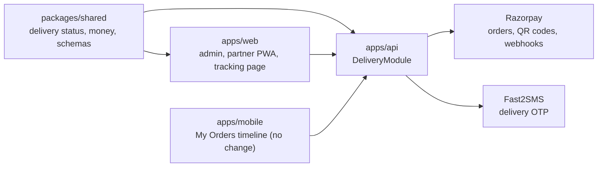
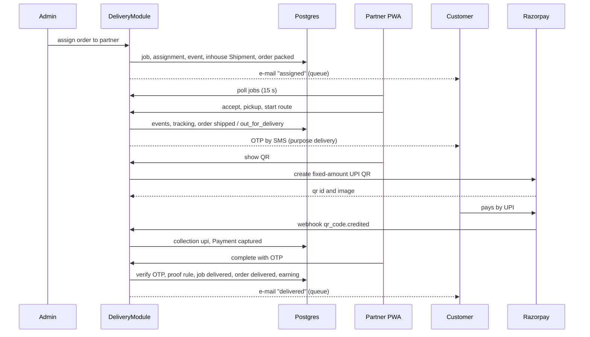

# Delivery Module: Dependencies and Data Flow

## 1. Dependency matrix

Rows depend on columns. `x` = direct call, `q` = through the queue, `d` = reads or writes the same table only.

| Component | Prisma | Shared | Orders tables | Payment tables | SMS port | Storage port | Notification svc | Settings | Redis/BullMQ |
|---|---|---|---|---|---|---|---|---|---|
| PartnerRegistry | x | x | | | | | | | |
| PartnerAuth | x | x | | | | | | | |
| DeliveryJobs | x | x | d | | | | q | x | x |
| OrderSync | x | x | d | | | | | | |
| DeliveryOtp | x | | | | x | | | x | |
| Collection | x | x | d | d | | | | x | q |
| CashLedger | x | x | | | | | | x | |
| Proof | x | x | | | | x | | x | |
| Tracking | x | x | d | | | | | | |
| DeliveryNotifier | x | | d | | | | x | | q |
| QR adapter | | | | | | | | | |
| WebhookEventRouter | | | | | | | | | |

Modules the delivery module imports: `PrismaModule`, `SettingsModule` (admin), `AuditLogModule` (admin), `QueueModule`, SMS, storage, notifications integration (global), `PaymentIntegrationModule` (for the QR methods).

Modules that import delivery: none. The two touch points go the other way and need no import:
- `FulfilmentService.createShipment` asks Prisma whether an active `DeliveryJob` exists (table read only).
- `PaymentService.handleWebhook` calls `WebhookEventRouter`, a small registry that lives in the checkout area; `DeliveryModule` registers its handler at start-up.

No circular imports.

## 2. Package dependency

Text alternative: shared is used by the API and the web app; the web app and the mobile app call the API; the API calls Razorpay and Fast2SMS.

## 3. Data flow: assign to delivered (COD with UPI QR)

Text alternative: the admin assigns, the partner accepts and starts the route, the customer receives the OTP, the partner shows a QR created through Razorpay, the customer pays, Razorpay confirms by webhook, the partner enters the OTP and the job and order become delivered; e-mails go through the queue.

## 4. Communication patterns

| Between | Pattern | Why |
|---|---|---|
| Web and API | REST with JSON, zod validated | same as the rest of Belzo |
| Partner app and API | REST, short polling every 15 s for jobs, 3 s for QR status while a QR is shown | simple, no push in Phase 1 (D7) |
| Delivery and orders | Same database, same transaction | one source of truth |
| Delivery and Razorpay | HTTPS through the resilient client; webhook with signature | existing pattern |
| Delivery and notifications | queue (`delivery` queue, job `notify`) | retries, no delay for the partner |
| Checkout and delivery (QR webhook) | registry callback | no import cycle |

## 5. Failure behaviour

| Failure | Result |
|---|---|
| SMS provider down on route start | job still moves; partner sees "Resend OTP" |
| Razorpay QR API down or QR Codes not enabled | partner sees "UPI QR not available, collect cash" |
| Webhook delayed | partner screen keeps polling; admin can see the Razorpay payment on the QR record; nothing is auto-confirmed without Razorpay's say |
| Worker down | timeouts and QR expiry wait; health check reports the stale worker heartbeat |
| Redis down | commands still work; notifications are retried when it returns |
