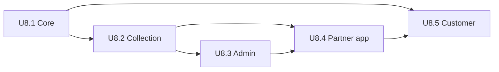

# Delivery Module: Unit Dependencies and Build Order

## Dependency matrix

Rows depend on columns. `x` = needs the unit's code to be present, `-` = no dependency.

| Unit | U8.1 | U8.2 | U8.3 | U8.4 | U8.5 |
|---|---|---|---|---|---|
| U8.1 Delivery core | - | - | - | - | - |
| U8.2 Collection, cash and proof | x | - | - | - | - |
| U8.3 Admin screens | x | x | - | - | - |
| U8.4 Partner app | x | x | - | - | - |
| U8.5 Customer side | x | - | - | - | - |

U8.3 and U8.4 call API routes from both U8.1 and U8.2. U8.5 needs only the job events and tokens from U8.1.

## Build order (decision U1 = A)

1. U8.1 Delivery core
2. U8.2 Collection, cash and proof
3. U8.3 Admin screens
4. U8.4 Partner app
5. U8.5 Customer side

U8.5 does not depend on U8.2 to U8.4, so it could move earlier, but the order above gives you the full flow (assign, deliver, collect) to try after U8.4 and customer messages last.

Text alternative: U8.1 comes first; U8.2 and U8.5 build on it; U8.3 and U8.4 build on U8.1 and U8.2; the planned sequence is U8.1, U8.2, U8.3, U8.4, U8.5.

## Shared resources and contracts

| Resource | Owner unit | Used by |
|---|---|---|
| `packages/shared/src/delivery` | U8.1 | all units |
| API contracts (zod schemas in shared) | U8.1, U8.2 | U8.3, U8.4, U8.5 |
| `CompletionGate` extension point | U8.1 | U8.2 registers payment and proof gates |
| `delivery` queue | U8.1 | U8.2 adds `qr-expiry`, U8.5 adds `notify` |
| `DeliverySettings` keys | U8.1 | U8.2 adds proof and QR keys at use |
| Payment port QR methods | U8.2 | none outside delivery |

## Testing checkpoints

- After U8.1 and U8.2: shared, api `tsc`, `eslint`, `jest`; property tests (state machine, ledger, money, OTP).
- After U8.3 and U8.4: web `tsc`, `eslint`, `jest`; local end-to-end walk through.
- After U8.5: all four workspaces, then full Build and Test stage.

## Integration points and risk

| Point | Unit | Risk | Mitigation |
|---|---|---|---|
| Mock shipment cancel on assign | U8.1 | order stuck without shipment | `OrderSyncService` creates the `inhouse` Shipment in the same transaction |
| Razorpay QR | U8.2 | feature not enabled on account | clear fallback to cash; real check reported at the end of U8.2 |
| Webhook routing | U8.2 | breaking existing payment webhooks | router only for the `qr_code.` prefix; existing payment tests must stay green |
| Env secrets | U8.1 | missing `JWT_PARTNER_SECRET` on server | env schema fails fast at start-up; added to `.env.prod` at deploy time |

Rollback: migrations are additive. If a unit is not deployed, nothing changes for current orders.
