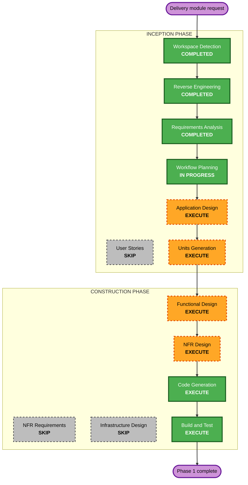

# Execution Plan: Delivery Module (U8)

Requirements: `aidlc-docs/inception/requirements/delivery-module-requirements.md` (approved 2026-10-23).

## Detailed Analysis Summary

### Transformation Scope
- **Transformation Type**: Migration (PHP to TypeScript) plus new feature inside an existing monorepo. Application change, no deployment model change.
- **Primary Changes**: New API module `delivery`, new Prisma models, shared state machine, admin screens, partner PWA, customer tracking.
- **Related Components**: orders (status sync, timeline), checkout/payment-gateway (Razorpay QR, webhook), integrations/shipping (replace mock for assigned orders), integrations/sms (delivery OTP), integrations/notifications (e-mail), integrations/storage (proof photos), admin RBAC, mobile app (timeline only).

### Change Impact Assessment
- **User-facing changes**: Yes. Customer timeline and e-mails, public tracking page, new partner app, new admin screens.
- **Structural changes**: Yes. New API module and new web route groups `/partner`, `/t/[token]`.
- **Data model changes**: Yes. About 12 new tables (partner, zone, zone pincode, job, assignment, event, otp, collection, cash ledger, settlement, proof, rating, QR payment). `Order` is not duplicated.
- **API changes**: Yes. New admin, partner and public endpoints. One new Razorpay webhook branch (`qr_code.credited`). No change to existing customer endpoints beyond extra timeline fields.
- **NFR impact**: Yes. Security (partner auth, object-level access, OTP, webhook), resiliency (idempotent webhook, queue jobs), money correctness.

### Component Relationships
- **Primary**: `apps/api/src/modules/delivery` (new)
- **Shared**: `packages/shared` (state machine, zod schemas, money helpers)
- **Dependent**: `modules/orders` (status sync and timeline), `modules/payment-gateway` (webhook routing), `apps/web` (admin, partner, tracking, My Orders), `apps/mobile` (My Orders timeline)
- **Supporting**: BullMQ worker (repeatable jobs), Prisma migration, RBAC seed, health check

| Component | Change Type | Reason | Priority |
|---|---|---|---|
| packages/shared | Minor (additive) | state machine, schemas | Critical (first) |
| apps/api prisma + delivery module | Major | core | Critical |
| apps/api orders and shipping | Minor | sync status, replace mock for assigned orders | Critical |
| apps/api payment-gateway webhook | Minor | QR credited branch | Critical |
| apps/web admin | Major | new screens | Important |
| apps/web partner PWA | Major | partner app | Critical |
| apps/web tracking and My Orders | Minor | timeline, public page | Important |
| apps/mobile | Minor | timeline in My Orders | Optional (end of Phase 1) |

### Risk Assessment
- **Risk Level**: High (money handling, new auth realm, order status coupling, new external flow).
- **Rollback Complexity**: Moderate. Migrations are additive; the feature is only reached when an admin assigns an order, so unassigned orders behave exactly as today.
- **Testing Complexity**: Complex (state machine, ledger, webhook idempotency, real Razorpay QR check).

## Workflow Visualization

Text alternative: Workspace Detection, Reverse Engineering, Requirements Analysis (done), Workflow Planning (now), Application Design, Units Generation, then per unit Functional Design, NFR Design, Code Generation, and finally Build and Test. User Stories, NFR Requirements and Infrastructure Design are skipped.

## Phases to Execute

### INCEPTION PHASE
- [x] Workspace Detection (COMPLETED)
- [x] Reverse Engineering of the PHP module (COMPLETED)
- [x] Requirements Analysis (COMPLETED, approved)
- [x] User Stories (SKIPPED)
  - **Rationale**: Requirements are itemised (DL-x) with behaviour written out; users are three known roles (admin, partner, customer). Same decision as the earlier cycle.
- [ ] Workflow Planning (IN PROGRESS)
- [ ] Application Design - EXECUTE
  - **Rationale**: New module, new services (state machine, assignment, OTP, collection, QR, ledger, tracking) and their dependencies on orders, payment and notifications must be defined first.
- [ ] Units Generation - EXECUTE
  - **Rationale**: Large, multi-package work. Split into units that each build and test on their own (see below).

### CONSTRUCTION PHASE (per unit)
- [ ] Functional Design - EXECUTE
  - **Rationale**: Data model, state transitions, OTP rules, cash ledger and money rules need exact definition.
- [ ] NFR Requirements - SKIP
  - **Rationale**: Tech stack is fixed (NestJS, Prisma, BullMQ, Next.js) and the NFRs are already written in the requirements (NFR-D1 to D7).
- [ ] NFR Design - EXECUTE
  - **Rationale**: Security and Resiliency extensions are enabled; patterns (partner auth realm, lockout, idempotent webhook, append-only triggers, queue retries) must be designed and checked.
- [ ] Infrastructure Design - SKIP
  - **Rationale**: No new infrastructure. Existing Postgres, Redis, BullMQ worker and storage are used. Only a Razorpay webhook event subscription (`qr_code.credited`) and `delivery.*` settings are added; both are recorded in the build notes.
- [ ] Code Generation - EXECUTE (ALWAYS), per unit
- [ ] Build and Test - EXECUTE (ALWAYS)

### OPERATIONS PHASE
- [ ] Operations - PLACEHOLDER

## Proposed Units (Phase 1)

| Unit | Content | Depends on |
|---|---|---|
| U8.1 Delivery core | shared state machine and schemas, Prisma models and migration, partners, zones, partner auth, assignment, status changes, delivery OTP, settings, RBAC permissions, worker jobs | none |
| U8.2 Collection and cash | COD cash, Razorpay UPI QR creation and webhook branch, cash ledger, settlements, earnings, order and `Payment` sync | U8.1 |
| U8.3 Admin screens | `/admin/delivery/*`: dashboard, jobs, partners, zones, cash, settings; assign button on order detail | U8.1, U8.2 |
| U8.4 Partner app | `/partner/*` PWA: login, job list, job detail, status actions, OTP entry, proof, cash and QR, online toggle | U8.1, U8.2 |
| U8.5 Customer side | order status sync and My Orders timeline, `/t/[token]`, rating, e-mails, in-app notifications, Android app timeline | U8.1 |

## Package Change Sequence
1. `packages/shared` (state machine, schemas, money helpers)
2. `apps/api` (U8.1, then U8.2, then the U8.5 API parts)
3. `apps/web` (U8.3, U8.4, U8.5 pages), in parallel once the API contracts exist
4. `apps/mobile` timeline (last, optional for Phase 1 sign-off)

Testing checkpoints: after U8.1 (state machine, OTP, auth, permissions), after U8.2 (ledger, QR webhook, idempotency), after the web units (type check, lint, component tests), then a full build and test run. Rollback: do not deploy until the user says so; migrations are additive.

## Estimated Timeline
- **Total units**: 5 (Phase 1). Phases 2 and 3 are separate cycles.
- **Estimated effort**: large; delivered unit by unit with a check-in after each one.

## Success Criteria
- **Primary Goal**: An admin assigns an order to a partner; the partner delivers it with OTP and collects COD by cash or Razorpay UPI QR; the customer follows it.
- **Key Deliverables**: the five units above with tests and updated docs.
- **Quality Gates**: `tsc`, `eslint` and `jest` clean in api, web, shared and mobile; property-based tests for state machine, ledger and money; Security, Resiliency and PBT extension compliance recorded per unit; real Razorpay QR check before sign-off.
