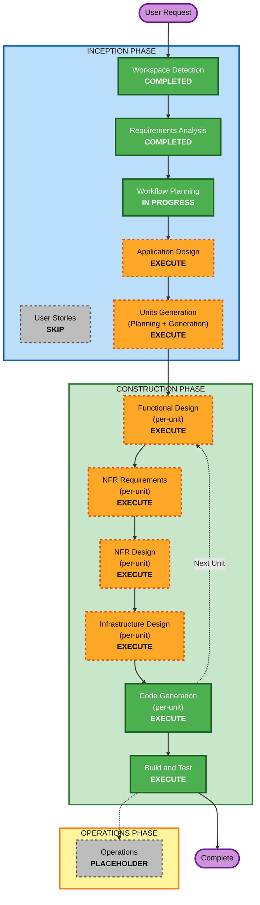

# Execution Plan — Belzo eMart E-Commerce Portal (Phase 1)

## Detailed Analysis Summary

### Transformation Scope
- **Project Type**: Greenfield (new build, no existing code).
- **Primary Changes**: Full-stack application from scratch — Next.js storefront + NestJS API +
  PostgreSQL, plus an admin panel, Razorpay and ShipRocket integrations, on AWS.

### Change Impact Assessment
- **User-facing changes**: Yes — entire customer storefront and admin UI.
- **Structural changes**: Yes — new system architecture, modular monolith with clear service boundaries.
- **Data model changes**: Yes — complete relational schema (users, catalogue, cart, orders, payments,
  shipments, coupons, reviews, CMS, settings).
- **API changes**: Yes — new REST API surface shared by web now and Flutter app later.
- **NFR impact**: Yes — Security, Resiliency, and PBT extensions all enabled as blocking constraints.

### Risk Assessment
- **Risk Level**: High (payments, PII, tax/compliance, broad surface area).
- **Rollback Complexity**: Moderate (version-pinned redeploy; DB migrations reversible).
- **Testing Complexity**: Complex (unit + integration + API + E2E + property-based tests).

## Workflow Visualization



### Text Alternative (workflow representation)
```
INCEPTION PHASE
- Workspace Detection ............ COMPLETED
- Requirements Analysis .......... COMPLETED
- User Stories ................... SKIP
- Workflow Planning .............. IN PROGRESS
- Application Design ............. EXECUTE
- Units Generation ............... EXECUTE

CONSTRUCTION PHASE (per-unit loop, repeated for each unit)
- Functional Design .............. EXECUTE
- NFR Requirements ............... EXECUTE
- NFR Design ..................... EXECUTE
- Infrastructure Design .......... EXECUTE
- Code Generation ................ EXECUTE
- Build and Test (after units) ... EXECUTE

OPERATIONS PHASE
- Operations ..................... PLACEHOLDER
```

## Phases to Execute

### INCEPTION PHASE
- [x] Workspace Detection (COMPLETED)
- [x] Requirements Analysis (COMPLETED)
- [x] User Stories (SKIPPED)
  - **Rationale**: User chose Approve & Continue without adding stories. Requirements are already
    itemised with FR/NFR IDs that serve the same traceability purpose for a single-vendor MVP. Can be
    added later if desired.
- [x] Workflow Planning (IN PROGRESS)
- [ ] Application Design - EXECUTE
  - **Rationale**: Many new components and services (auth, catalogue, cart, checkout, payments, orders,
    fulfilment, admin, notifications). Interfaces, service orchestration, and dependencies must be
    defined before decomposition and coding.
- [ ] Units Generation - EXECUTE
  - **Rationale**: The system is large enough to warrant decomposition into logical units/modules built
    in dependency order, each fully designed and coded before the next.

### CONSTRUCTION PHASE (per-unit)
- [ ] Functional Design - EXECUTE
  - **Rationale**: Complex business logic (pricing, tax split, coupons, inventory, order state machine)
    needs detailed design; also required for PBT-01 property identification.
- [ ] NFR Requirements - EXECUTE
  - **Rationale**: Confirm per-unit tech choices and select PBT framework (fast-check) per PBT-09.
- [ ] NFR Design - EXECUTE
  - **Rationale**: Apply Security and Resiliency patterns (auth, rate limiting, circuit breakers,
    caching, observability) per unit.
- [ ] Infrastructure Design - EXECUTE
  - **Rationale**: Map to AWS services (RDS PostgreSQL, ElastiCache Redis, S3+CloudFront, ECS/Fargate or
    equivalent, SES), CI/CD (GitHub Actions), backups, multi-zone single-region topology.
- [ ] Code Generation - EXECUTE (ALWAYS)
  - **Rationale**: Implement each unit with tests (unit + integration + PBT).
- [ ] Build and Test - EXECUTE (ALWAYS)
  - **Rationale**: Build all units, run full test suites, integration + critical E2E flows.

### OPERATIONS PHASE
- [ ] Operations - PLACEHOLDER
  - **Rationale**: Future deployment/monitoring; resiliency test scenarios captured here per RESILIENCY-14.

## Proposed Units of Work (to be finalised in Units Generation)
Built in dependency order:
1. **platform-core** — shared config, i18n, logging, error handling, security middleware, DB setup,
   design system/UI shell.
2. **identity** — auth (OTP/email/social), users, addresses, RBAC, sessions/JWT.
3. **catalogue** — categories, products, variants, attributes, brands, inventory, search abstraction.
4. **cart-checkout** — cart, coupons/pricing/tax engine, checkout, Razorpay payment.
5. **orders-fulfilment** — order state machine, invoices (GST), ShipRocket shipments, returns, refunds.
6. **engagement** — wishlist, reviews/Q&A, wallet/loyalty, notifications, support tickets, CMS.
7. **admin** — admin panel across dashboard, catalogue, orders, marketing, customers, reports, settings.

(Exact unit list and boundaries are confirmed during Units Generation with your input.)

## Estimated Timeline
- **Total Stages**: 2 remaining INCEPTION stages + per-unit CONSTRUCTION loop (7 proposed units) + Build
  and Test.
- **Estimated Duration**: Multi-iteration build; each unit is designed and coded before the next, with
  approval gates throughout.

## Success Criteria
- **Primary Goal**: A running, tested single-vendor B2C web storefront + admin panel with working
  catalogue → cart → checkout → payment → order → fulfilment path.
- **Key Deliverables**: Source code, DB schema + migrations, API docs (OpenAPI), architecture doc,
  admin user manual, deployment guide, test + security checklist.
- **Quality Gates**: Security Baseline, Resiliency Baseline, and PBT compliance verified at each stage;
  build and full test suite green.
